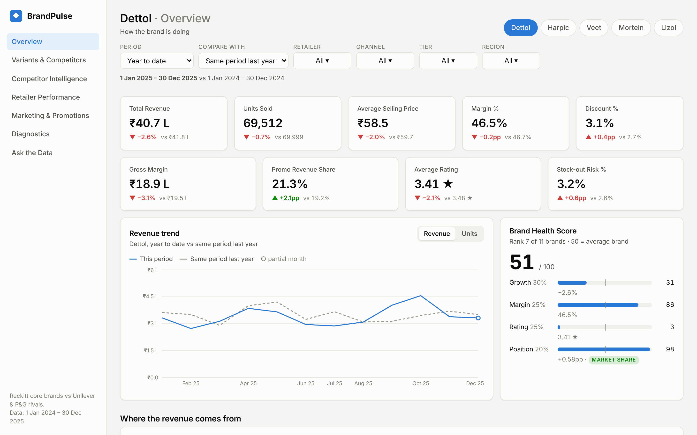
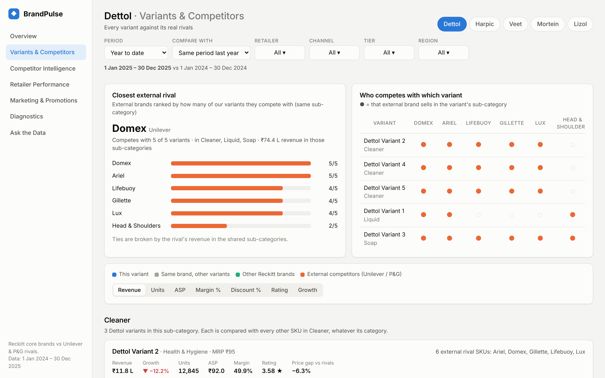
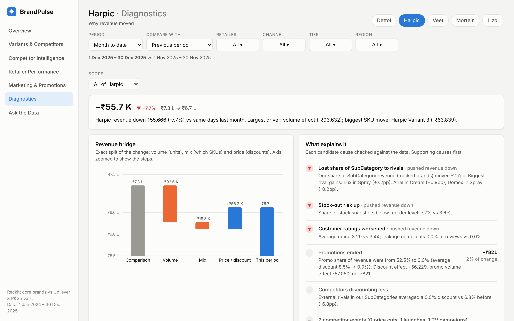
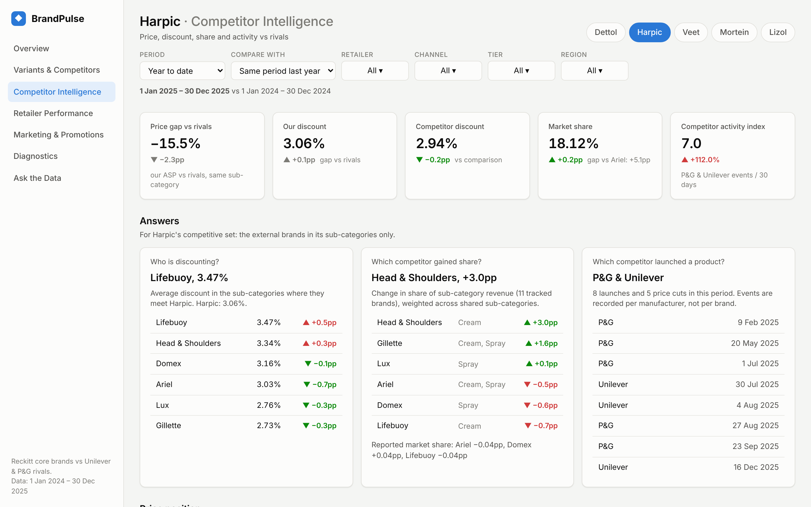
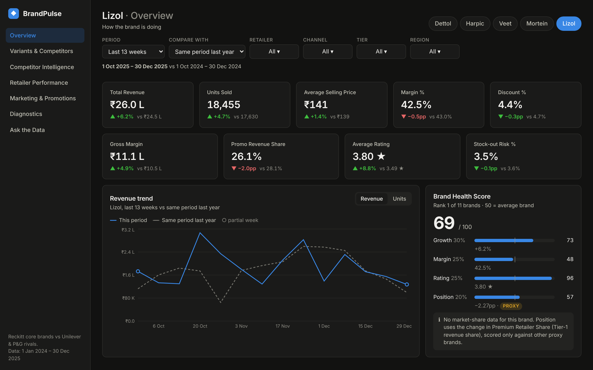

# BrandPulse

Brand intelligence platform that tracks Reckitt's 5 core brands (Dettol, Harpic, Veet, Mortein, Lizol) against their real Unilever and P&G competitors.

Built during a Data Engineer internship at KaarTech on the *Brand Intelligence Accelerator* dataset: 20,440 transactions, 55 SKUs, 11 brands, 3 manufacturers, 2024–2025.



<table><tr>
<td><br/><sub>Every variant vs its same-sub-category rivals in 3 tiers</sub></td>
<td><br/><sub>Why revenue moved: exact bridge + checked causes</sub></td>
</tr><tr>
<td><br/><sub>Price gap, discounting, share and competitor activity</sub></td>
<td><br/><sub>Dark mode · Lizol with the labelled market-position proxy</sub></td>
</tr></table>

## Architecture

```
Excel workbook (10 sheets)
   │
   ▼
pipeline/   L0  typed ingestion + 46 validation checks  → reports/data_quality.md
            L1  enriched model                          → data/processed/*.parquet
   │
   ▼
kpi/        L2  KPI registry (26 KPIs) · engine · Time Intelligence (12 presets × 2 comparisons) · Health Score
            L3  competitor mapping (3 tiers) · competitor KPIs · diagnostics (exact revenue bridge + causes)
   │
   ├──► api/            FastAPI: one endpoint per page + generic KPI endpoint
   │       ├──► web/            React dashboard for brand managers (7 pages)
   │       └──► llm/            grounded Q&A: tools → engine, hybrid RAG, figure verifier (Gemini / Ollama / offline)
   └──► streamlit_app/  analyst workbench
```

All numbers in the dashboard, the workbench and the Q&A come from the same `kpi.engine.Engine`, so they always agree.

## What the data shows (2025 vs 2024)

From [the Phase 1 notebook](notebooks/phase1_eda.ipynb) and the dashboard:

- Core brands' revenue fell **2.3%** while the competitor brands grew **1.2%**. Veet is the only growing core brand (+2.9%).
- **Promotions cost revenue.** Units per promo transaction are only +1.3% vs non-promo transactions in the same months, so the 10–15% discount leaves revenue per promo transaction 12% lower.
- **Dettol had a packaging-leakage incident**: all 27 leakage complaints in the data are Dettol, all in Q2 2025, across all 5 SKUs.
- **Dettol is priced far below its rivals**: about 44% under the external rivals' average selling price in its sub-categories.
- Lizol and Mortein have no market-share data; their Health Score uses a labelled proxy (Premium Retailer Share).

## Quick start

```bash
python -m venv .venv && source .venv/bin/activate
pip install -r requirements.txt
make data        # validate the workbook and build data/processed/
make test        # 100 tests: KPIs recomputed by hand from the raw Excel
make notebook    # re-run the Phase 1 EDA notebook
```

## Dashboard

```bash
make build   # build the React app once
make api     # serves API + dashboard on http://localhost:8000
# or, while developing the UI:  make api  (one terminal)  +  make web  (another) → http://localhost:5173
```

Pick one of the 5 Reckitt brands; every page then shows only that brand and its real competitors:

| Page | What it answers |
|---|---|
| Overview | KPI cards vs comparison, revenue trend vs same period last year, Health Score breakdown, revenue by sub-category / category / retailer / region / channel |
| Variants & Competitors | each variant vs every same-sub-category SKU in 3 colours (same brand, other Reckitt, external), closest external rival, variant × rival matrix |
| Competitor Intelligence | price gap, discount gap, competitor discount, market share gap, activity index; *who is discounting / gained share / launched* |
| Retailer Performance | revenue, margin, price index, promo response, growth and top SKUs per retailer |
| Marketing & Promotions | promo lift and cost for the brand; company-wide campaign spend and ROI (labelled) |
| Diagnostics | exact volume / mix / price bridge, evidence-checked causes, where the change happened |
| Ask the Data | questions answered from the KPI engine (Phase 6) |

The view (brand, period, comparison, filters) is kept in the URL, so any view can be bookmarked or shared.

## Analyst workbench (Streamlit)

```bash
make streamlit   # http://localhost:8501
```

Data-quality report · KPI explorer (any KPI × any brands × any dimension × any period) · competitor map with CSV download · Health Score lab (try other weights) · KPI glossary and Time Intelligence table · Q&A evaluation results.

## Ask the Data (grounded LLM Q&A)

```bash
cp .env.example .env            # then set LLM_PROVIDER and the key / model
make api                        # the Ask page and the Diagnostics "Explain" button use it
make eval                       # 42-question evaluation → reports/llm_eval.md
```

| Provider | Setup | Cost |
|---|---|---|
| `gemini` | free key from aistudio.google.com/apikey in `GEMINI_API_KEY` | free tier (per-model daily quota; the client falls back along `GEMINI_MODELS`) |
| `ollama` | install Ollama, `ollama pull qwen2.5:7b` | free, local |
| `offline` | nothing | free; keyword routing + templates, also the automatic fallback |

How an answer is produced:

1. The model gets the question, the dashboard context and **8 tools** (`get_kpi`, `get_breakdown`, `get_trend`, `get_competitors`, `get_variants`, `explain_change`, `get_health_scores`, `search_knowledge`). It never sees raw data.
2. Tool arguments are validated against the KPI registry, brand list and period presets; the KPI engine computes.
3. `search_knowledge` retrieves definitions, rules and data caveats: Chroma with local all-MiniLM-L6-v2 embeddings, fused with BM25 (reciprocal-rank fusion).
4. **Every figure in the draft answer is checked** against the tool results at the precision it is written (₹40.7 L = ₹40,70,000 ± ₹5,000). Unsupported figures trigger one retry naming them; if any remain, those sentences are dropped or the grounded offline answer is used.
5. Missing data (e.g. Lizol market share, brand-level campaign spend, forecasts, 2023) is answered with "the data doesn't cover this", never a guess.

## API

```bash
make api   # http://localhost:8000/docs
```

| Endpoint | Page |
|---|---|
| `GET /api/meta` | brands, presets, filter options, KPI catalog, data caveats |
| `GET /api/brands/{brand}/overview` | KPI cards, trend vs comparison, breakdowns, Health Score |
| `GET /api/brands/{brand}/variants` | every variant vs its 3-tier rivals, closest rivals, variant × rival matrix |
| `GET /api/brands/{brand}/competitors` | price gap, discount gap, market share gap, activity, answers |
| `GET /api/brands/{brand}/retailers` | retailer table, top SKUs, price index, promo response, answers |
| `GET /api/brands/{brand}/marketing` | brand promotions + company-wide campaigns |
| `GET /api/brands/{brand}/diagnostics` | why revenue moved |
| `GET /api/kpi/{kpi}` | any KPI as a value, breakdown (`by=`) or series (`grain=`) |

All take `period` (or `start`+`end`), `mode` (`yoy`/`previous`/`none`), `as_of`, and comma-separated `retailers`, `channels`, `tiers`, `regions`.

## Using the KPI engine

```python
from kpi.engine import Engine
from kpi.filters import Filters

eng = Engine()
dettol = Filters.make(brands="Dettol")

eng.value("revenue", dettol, period="YTD")                       # one number
eng.compare("asp", dettol, period="MTD", mode="previous")        # vs. same days last month
eng.breakdown("price_index", "Retailer", dettol, period="L13W")  # per retailer
eng.timeseries("revenue", grain="W", filters=dettol, period="R90")
```

**Time Intelligence presets:** `WTD MTD QTD YTD R7 R30 R90 PM PQ L13W PY ALL`, or a `(start, end)` tuple.
**Comparison modes:** `previous` (the period before, same shape) and `yoy` (same period last year).

### Competitors and diagnostics

```python
from kpi.competitive import Competitive
from kpi.diagnostics import Diagnostics

comp = Competitive(eng)
comp.closest_rivals("Dettol")            # external brands ranked by variant overlap
comp.variant_table("Dettol", "YTD")      # each variant vs its 3-tier rivals
comp.price_position("Dettol", "YTD")     # price gap %, discount gap, competitor discount %
comp.answers("Dettol", "YTD")            # who is discounting / gained share / launched

Diagnostics(eng, comp).explain("Harpic", "MTD", "previous")   # why revenue moved
```

The full variant-to-rival mapping is in [reports/competitor_map.csv](reports/competitor_map.csv).

**KPIs:** run `python -c "from kpi.registry import catalog; print(catalog()[['id','name','formula_text']])"` to list them with their formulas.

## Project status

| Phase | Contents | Status |
|---|---|---|
| 0 | Repo, CI, Makefile | ✅ |
| 1 | Validation, data model, KPI engine, Time Intelligence, Health Score, tests, EDA notebook | ✅ |
| 2 | Competitor mapping (3 tiers), competitor KPIs, diagnostics engine | ✅ |
| 3 | FastAPI (page endpoints + generic KPI endpoint, global filters) | ✅ |
| 4 | React dashboard (7 pages, brand-centric, every chart reacts to brand/period/filters) | ✅ |
| 5 | Streamlit workbench (data quality, KPI explorer, competitor map, Health Score lab, glossary, Q&A eval) | ✅ |
| 6 | Grounded LLM Q&A (Gemini / Ollama / offline), hybrid retrieval, figure verifier, 42-question evaluation | ✅ |
| 7 | Docs, screenshots | ⏳ |

See [docs/DECISIONS.md](docs/DECISIONS.md) for every definition and data caveat.
